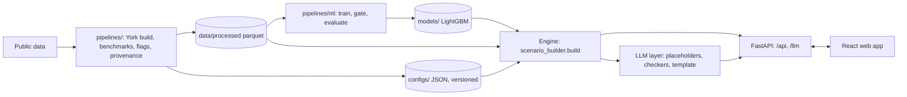

# Green Home Score — Lloyds PS2, Megathon X (City of York)

Every York home with an Energy Performance Certificate (65,872 homes) gets a **Green Home Score out of 100**, a list
of the retrofits it can **physically** take, and what each one would do to its **gas, electricity, carbon, bills, EPC
band and value** — all computed by a deterministic, auditable engine from public data. Machine-learning models add an
indicative EPC change and value range, and ship only if they beat a simple baseline. A web app walks a homeowner
through it in four steps, and an LLM explains the result in plain English **without ever writing a number itself**.

| | |
|---|---|
| Study area | City of York (local authority E06000014), 65,872 homes from 95,348 EPC certificates |
| Stack | Python 3.14 · FastAPI · pandas/pyarrow · LightGBM · React 19 + TypeScript + Vite |
| Data | Open government data only (EPC, DESNZ NEED, Land Registry, DESNZ carbon factors) — **[download](#1-data)** |
| Decisions | Every design choice is logged in [`docs/DECISIONS.md`](docs/DECISIONS.md) (D1–D47) |
| Full technical report | [`PROJECT_IMPLEMENTATION_REPORT.md`](PROJECT_IMPLEMENTATION_REPORT.md) |
| Licence | Code: [MIT](LICENSE) · data: Open Government Licence v3.0 (see §11) |

---

## Contents

1. [Data](#1-data)
2. [Quick start](#2-quick-start)
3. [What it does](#3-what-it-does)
4. [How it works](#4-how-it-works)
5. [Results](#5-results)
6. [Commands](#6-commands)
7. [Configuration](#7-configuration)
8. [Repository layout](#8-repository-layout)
9. [Testing](#9-testing)
10. [Limitations](#10-limitations)
11. [Privacy and licences](#11-privacy-and-licences)
12. [Documentation index](#12-documentation-index)

---

## 1. Data

The data is **not in git** (`data/` and `dataset/` are git-ignored: about 170 MB processed, 8.3 GB raw).

**Download: [Google Drive — project data](https://drive.google.com/file/d/1c7r9Rfmo-o2rHwgGTbz244gTtOXkh4JU/view?usp=sharing)**

Extract it at the repository root so the code finds:

```text
data/processed/region=york/homes_tagged.parquet     # the York build used at runtime (+ other York tables)
data/processed/need_4m.parquet, need_50k.parquet    # NEED samples (benchmarks, energy models)
data/processed/ppd.parquet                          # Land Registry Price Paid, category A
dataset/                                            # raw inputs — only needed to rebuild from scratch
```

Check it with `make data-check` (9 integrity and leakage checks, all should PASS).

**Without the data** the app still runs: the API serves the three public demo homes (`/api/health` reports
`data_mode: demo_homes`), and the web app also has an offline snapshot that needs no backend at all.

### Sources

| Source | Publisher | Used for | Licence |
|---|---|---|---|
| EPC domestic certificates and recommendations 2008–2026 (bulk zip, streamed and filtered to York) | MHCLG | home state, score, feasibility, ML features, assessor recommendations | OGL v3.0; address fields © OS / Royal Mail, restricted use |
| NEED anonymised data 2026 (50k and 4M samples) | DESNZ | gas/electricity benchmarks, energy models, Monte Carlo spread | OGL v3.0 |
| NEED Impact of measures 2026 (installed 2023) | DESNZ | measured retrofit savings, combination calibration | OGL v3.0 |
| Price Paid Data 2025–2026 | HM Land Registry | value model (4,000 of 4,095 York sales linked) | OGL v3.0 |
| GHG conversion factors 2026 | DESNZ | carbon: gas 0.18231, electricity 0.14395 kg CO₂e/kWh | OGL v3.0 |
| ECUK 2026 end-use tables | DESNZ | split of gas into cooking / space / water heating | OGL v3.0 |
| Ofgem price cap Oct–Dec 2026, Boiler Upgrade Scheme | Ofgem, gov.uk | bills, grants, payback | – |

Details, fields and preprocessing rules: [`docs/DATA.md`](docs/DATA.md). The scripts that produced
`need_*.parquet` and `ppd.parquet` are not in the repository (their rules are in `docs/DATA.md` §1.2 and §1.4).

---

## 2. Quick start

Requirements: Python 3.14, Node 22, GNU Make.

```bash
python3 -m venv .venv && .venv/bin/pip install -r requirements.txt
cp .env.example .env              # optional: LLM keys (see §7); without keys everything works on templates
make web-install                  # npm ci in frontend/
make web                          # builds the web app and serves app + API on http://127.0.0.1:8000
```

Open http://127.0.0.1:8000 and pick an example home in the sidebar:

| Demo home | id | What it shows |
|---|---|---|
| A — 1967–75 detached house, EPC E, gas | `U100050529765` | score 44 "Poor"; loft infeasible (flat roof); heat pump raises electricity |
| B — 2003–06 electric flat, EPC B | `A012dcfda4e502be0` | loft and solar not suitable; savings estimated on electricity |
| C — missing data | `U100050565716` | score unavailable, never zero; every measure "needs verification" |

Development with hot reload (two terminals): `make api` (FastAPI on :8000, docs at `/docs`) and `make web-dev`
(Vite on :5173, proxying `/api` and `/llm`).

---

## 3. What it does

**For a homeowner (web app, four steps):**

1. **Your home** — score out of 100 and its class, what lets the home down most, yearly gas, electricity and carbon
   (labelled as a benchmark unless you enter a meter reading), an interactive house diagram.
2. **Your options** — three engine-chosen packages: cheapest that cuts emissions by at least 10%, biggest carbon
   cut, best carbon per pound; with cost after grants, bill change, payback, carbon, gas and electricity; a spending limit.
3. **Try changes** — add or remove measures, more or fewer people at home, heat-pump efficiency, your own meter
   reading; the engine recalculates in about 0.2 s.
4. **Your plan** — can I do it (permissions), can I afford it (cost, payback, illustrative loan), will it work for
   me; save the plan, download a decision record, print, a request letter for a landlord or freeholder, and a
   plain-English report.

**For a lender or council:** *Homes needing help* ranks York's homes by improvement potential, fabric-only potential,
carbon per pound or carbon saving (12,660 homes are Poor or Very poor).

**Method & evidence:** sources and licences, the score formula, simulation rules, measured vs assumed savings, and
every ML model against its baseline.

**Ask a question:** "How green is my home?", "What if I add a heat pump?", "What if gas costs 6p?", "My budget is
£5,000" — what-ifs rerun the engine and explain the difference.

---

## 4. How it works



**Engine** (`backend/app/services/`, the only writer of numbers; `docs/ENGINE.md`, `docs/SCORE.md`)

- **Score:** seven weighted parts — energy efficiency 25%, energy intensity 20%, insulation 15%, heating 15%,
  windows 10%, renewables 10%, smart controls 5% — with fixed mappings and train-only intensity percentiles.
  A missing part gives a range, not a guess; more than two missing → unavailable.
- **Feasibility:** feasible / infeasible / needs verification per measure (loft, cavity wall, solid wall, double
  glazing, smart thermostat, air-source heat pump, solar PV); unknown is never assumed feasible.
- **Baseline:** NEED median for the home's fuel × type × EPC band × floor-area cell (≥ 30 homes, else coarser); a
  meter reading replaces it.
- **Simulator:** measures in physical order; gas split into cooking / space / water (ECUK); NEED-measured savings
  with empirical-Bayes shrinkage by segment; electric homes via the NEED electric-heating split; a heat pump moves
  heat to electricity at a field-trial SCOP of 2.8 (2.44–3.5). **Gas and electricity are reported separately.**
- **Money:** bills at the Ofgem cap, Boiler Upgrade Scheme grant, payback, an illustrative 7%/10-year loan (not a
  Lloyds product).
- **Packages:** every combination of feasible measures (≤ 128), Pareto filter, three featured picks; 13
  one-at-a-time sensitivity reruns; a 300-draw Monte Carlo seeded by the scenario id.

**ML** (`backend/app/ml/`, `pipelines/ml/`, `models/`; `docs/ML.md`, `docs/EVALUATION.md`) — LightGBM models trained
here, each gated against a baseline on validation; the test split was scored once.

| Model | Purpose | Shipped |
|---|---|---|
| SAP regressor (monotone constraints) | indicative EPC change of a plan | yes |
| Value GBM + hedonic OLS + split-conformal interval | indicative value range (association, not causal) | yes |
| NEED energy quantile models (P10/P50/P90) | ranges | yes |
| NEED energy point models | replace the benchmark baseline | **no** — gained < 2%, gate failed |
| Per-measure assessor-relevance classifiers + ranking | priority order (install order stays physical) | yes (heat pump: rules only) |

**LLM layer** (`backend/app/llm/`; `docs/LLM_EVALUATION.md`)

1. The engine result becomes a fact sheet with stable keys; the LLM sees keys and descriptions, **never values**,
   and writes sentences with `{placeholders}`.
2. Code fills the placeholders; a rule checker (29 error codes: typed numbers, wrong direction, infeasible advice,
   unsupported claims, missing caveats…) rejects bad sentences, which are replaced by template sentences.
3. An independent number checker matches every number in the final text to an engine value.
4. If anything fails, or no provider is available, a deterministic template answers with the same numbers.

Providers (in order, each optional): Groq, Gemini, Anthropic, OpenRouter, DeepSeek. What-ifs are parsed into a
validated `ScenarioRequest`, with a keyword safety net for explicit requests the LLM misreads.

**Web app** (`frontend/`; `frontend/README.md`, `frontend/docs/API_CONTRACT.md`) — React 19, React Query, Zod (every
response is validated against the engine contract), Recharts; live mode or an offline snapshot generated from the
engine and checked against hand-calculated fixtures.

---

## 5. Results

| Area | Result | Source |
|---|---|---|
| SAP model (test, n 9,919) | MAE 3.46 SAP points (baseline 5.96), R² 0.80, EPC band within ±1: 99.8% | `docs/EVALUATION.md` |
| Value model (test, n 619) | median abs. error 9.0% (baseline 16.7%); 80% interval covered 82.1% | `docs/EVALUATION.md` |
| Recommender (test) | NDCG@3 0.995 vs engine order 0.521 (agreement with EPC assessors) | `docs/EVALUATION.md` |
| Simulator vs NEED | stacked fabric savings 5.6–13.8 pp above NEED medians (disclosed, D14/D17) | `docs/validation/simulator_vs_need.json` |
| LLM, live run (53 held-out questions) | groundedness 100% (401 numbers), factual accuracy 100%, unsupported claims 0%, what-if success 100%, 53/53 items pass; 42 answers LLM-written | `docs/LLM_EVALUATION.md` |
| Tests | backend 757 passed (real data), frontend 73 passed, data checks 9/9 | §9 |
| Speed | full scenario with packages, sensitivity and Monte Carlo ≈ 0.2 s | local run |

Known failures and what was done about each: [`docs/FAILURE_ANALYSIS.md`](docs/FAILURE_ANALYSIS.md).

---

## 6. Commands

| Command | What it does |
|---|---|
| `make web` | build the web app (live mode) and serve app + API on :8000 |
| `make api` / `make web-dev` | API on :8000 / Vite dev server on :5173 |
| `make web-install` | install frontend dependencies (`npm ci`) |
| `make test` | backend tests (unit, LLM layer, data integrity) |
| `make web-test` | frontend typecheck, lint and Vitest |
| `make data-check` | 9 data integrity and leakage checks |
| `make data-rebuild` | rebuild the York tables and configs from `dataset/` (≈ 2–5 min) |
| `make data-test` | unit + data-integrity tests |
| `make score` | score every home (`homes_scored.parquet`) |
| `make validate-sim` | simulator vs NEED measured combinations |
| `make elec-split`, `make combo-cal`, `make engine-cal` | build the electric split, combination and engine calibrations |
| `make ml` | `ml-data`, `ml-train`, `ml-predict`, `ml-explain`, `ml-eval` (long; the test split is scored once and `ml-eval` refuses to re-run) |
| `make ml-inspect` | schema-only data inventory (address columns never loaded) |
| `make llm-eval` | held-out LLM evaluation → `docs/LLM_EVALUATION.md` (uses provider quota when keys are set) |
| `make web-fixtures` | regenerate the web app's offline snapshot from the engine (parity-checked) |

Windows: `scripts\run_data.ps1 data-check | data-rebuild | data-test`.

**Data rebuild order** (deterministic, seed 42): `build_region.py --reuse-extract` → `build_catalogue.py` →
`freeze_score_params.py` (train only) → `tag_homes.py` → `build_feature_availability.py` → `select_demo_homes.py` →
`make_monthly_demo.py` (synthetic, annualisation demo only) → `audit_sales_matches.py`. `build_region` compares a
fingerprint with the previous run, so a rebuild gives identical outputs.

---

## 7. Configuration

Copy `.env.example` to `.env` (git-ignored). Everything is optional.

| Variable | Purpose |
|---|---|
| `GROQ_API_KEY`, `GEMINI_API_KEY`, `ANTHROPIC_API_KEY` | LLM providers (free tiers work) |
| `LLM_PROVIDERS` | order, e.g. `groq,gemini` (default: every provider with a key) |
| `LLM_<ROLE>_MODEL_<PROVIDER>` | model per role (`EXPLAIN`, `PARSE`, `JUDGE`), e.g. `LLM_EXPLAIN_MODEL_GROQ=openai/gpt-oss-20b` |
| `LLM_ENABLED=0` | template only (no provider calls) |
| `LLM_MAX_WAIT_S`, `LLM_TIMEOUT_S`, `LLM_RPM_*`, `LLM_TPM_*` | rate-limit waits and limits |
| `CORS_ORIGINS` | extra allowed origins (default: Vite ports) |
| `EPC_API_KEY` | EPC API (code lists only) |
| `VITE_DATA_MODE`, `VITE_API_BASE_URL` | frontend: `live` or `fixtures`, API base URL (`frontend/.env.example`) |

---

## 8. Repository layout

```text
backend/app/
  main.py, web_api.py      FastAPI: engine routes, /api/* for the web app, static web serving
  services/                engine: score, feasibility, baseline, simulator, impacts, carbon, money, packages,
                           sensitivity, uncertainty, portfolio, valuation, sap_model, energy_model, recommender
  ml/                      features, parsers, privacy-safe reader, splits, metrics, tuning, registry
  llm/                     explain, render, checker, numbers, templates, whatif, advise, client; prompts/
  schemas/, data/          ScenarioRequest / ScenarioResult; loaders (York parquet or demo homes)
pipelines/                 data build, calibration, validation; ml/ (training, evaluation); llm/ (evaluation)
configs/                   versioned configs: score mappings, catalogue, factors, prices, grants, finance, registry
models/                    shipped LightGBM models (text) + meta.json
frontend/                  React web app, offline snapshot (public/fixtures), API contract (docs/)
tests/                     unit/, llm/, data_integrity/, fixtures/ (hand calculations), reference/
eval/                      LLM evaluation set (53 questions), test-split predictions
docs/                      data, engine, score, ML, evaluation, LLM evaluation, decisions, failure analysis
deliverables/              M1 and M2 submissions (LaTeX + PDF)
```

---

## 9. Testing

```bash
make test        # 757 tests: engine (hand-calculated fixtures), ML, LLM layer (offline fakes), API, data integrity
make web-test    # typecheck + oxlint + 73 Vitest tests (contract parity, full app flows, transport, explanations)
make data-check  # 9/9
```

Tests never call a real LLM (the root `tests/conftest.py` disables providers). Tests that need the York data are
skipped without it.

---

## 10. Limitations

- Energy baselines are **population benchmarks** for similar homes, not this home's meter (labelled as such; a meter
  reading replaces them).
- Oil and other non-gas, non-electric homes (about 4%) get no fabric savings estimate — there is no metered baseline.
- Stacked fabric savings are optimistic against NEED by 5.6–13.8 percentage points (shown next to the NEED-calibrated figure).
- A heat pump alone in a gas-heated home gives a small modelled EPC fall (SAP is cost-based); only 10 observed pure swaps exist.
- Value is an **association** from 20 months of York sales, not a causal effect or a valuation.
- 32% of latest EPCs are older than 10 years (flagged).
- Engine calibration (area scaling, missing-part priors) is built but not applied (D30).
- No authentication, container or CI yet; this is a local demo.
- Live LLM answers take about a minute on free tiers; the app shows the template answer first.

---

## 11. Privacy and licences

- **Code:** MIT License, see [`LICENSE`](LICENSE). The data is not covered by it: it keeps its own licences below.
- Addresses and full postcodes are never loaded by the models, returned by the API or committed; every API response
  passes an address guard. Only the outward postcode (e.g. `YO31`) is shown.
- Home ids are the open EPC register's UPRN-based property ids (OGL; D47).
- Contains public sector information licensed under the Open Government Licence v3.0 (DESNZ, MHCLG). Contains HM Land
  Registry data © Crown copyright and database right 2026, licensed under the Open Government Licence v3.0.
- The illustrative loan is not a Lloyds product, rate or offer; nothing here is a lending, eligibility or credit decision.

---

## 12. Documentation index

| Document | Contents |
|---|---|
| [`PROJECT_IMPLEMENTATION_REPORT.md`](PROJECT_IMPLEMENTATION_REPORT.md) | full technical report, architecture, algorithms, results, presentation material |
| [`docs/DATA.md`](docs/DATA.md), [`docs/LABELS.md`](docs/LABELS.md) | sources, fields, preprocessing, labels |
| [`docs/SCORE.md`](docs/SCORE.md), [`docs/ENGINE.md`](docs/ENGINE.md) | score formula, engine rules |
| [`docs/ML.md`](docs/ML.md), [`docs/EVALUATION.md`](docs/EVALUATION.md) | model cards, ML results |
| [`docs/LLM_EVALUATION.md`](docs/LLM_EVALUATION.md) | LLM evaluation and disclosed changes |
| [`docs/DECISIONS.md`](docs/DECISIONS.md) | decision log D1–D47 |
| [`docs/FAILURE_ANALYSIS.md`](docs/FAILURE_ANALYSIS.md) | failures found across data, scoring, ML and LLM, with status |
| [`docs/FRONTEND_INTEGRATION.md`](docs/FRONTEND_INTEGRATION.md), [`frontend/docs/API_CONTRACT.md`](frontend/docs/API_CONTRACT.md) | web app integration and API contract |
| [`docs/DEMO_HOMES.md`](docs/DEMO_HOMES.md) | the three demo homes |
| [`deliverables/`](deliverables/) | M1 and M2 submissions |
